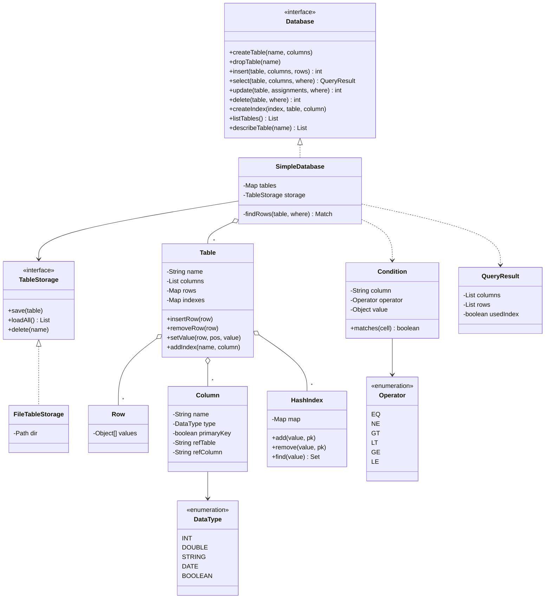
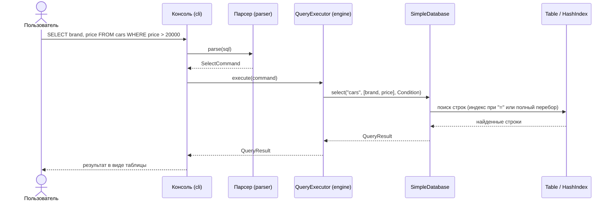
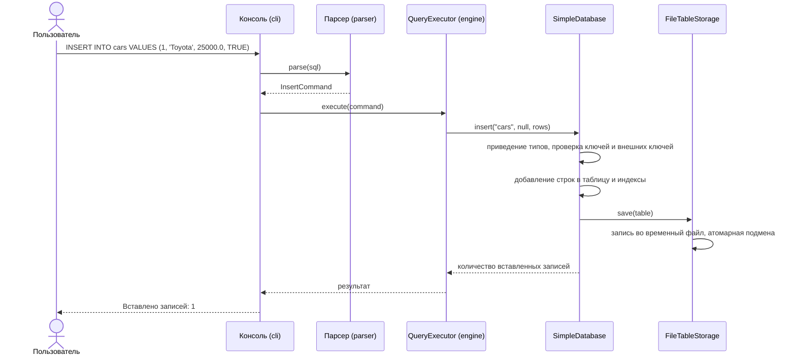

# Mini DBMS: упрощённая СУБД на Java

Лабораторная работа 2. Консольная СУБД с таблицами, связанными по ключу, SQL-подобным языком запросов, хранением данных на диске и индексами.

- Репозиторий: https://github.com/jentaeee/Lab_2_Java
- Язык: Java 8+ (проект собирается Maven, в `pom.xml` указана Java 11, код совместим с Java 8)
- Интерфейс: консольный
- Команда: Мыльникова Таисия Валерьевна 25КНТ2 (ветка `taya`), Манухина Мария Григорьевна 25КНТ2 (ветка `masha`)

## Содержание

1. [Возможности](#1-возможности)
2. [Архитектура системы](#2-архитектура-системы)
3. [Хранение данных и восстановление после сбоя](#3-хранение-данных-и-восстановление-после-сбоя)
4. [Индексы](#4-индексы)
5. [Результаты тестирования производительности](#5-результаты-тестирования-производительности)
6. [Инструкция пользователя](#6-инструкция-пользователя)
7. [Тестирование](#7-тестирование)
8. [Область ответственности участников](#8-область-ответственности-участников)
9. [Ограничения](#9-ограничения)
10. [Выводы](#10-выводы)
11. [Список использованных источников](#11-список-использованных-источников)

## 1. Возможности

- Минимум две таблицы, связанные внешним ключом (пример предметной области: марки автомобилей `brands` и автомобили `cars`).
- Типы данных: целое число (`INT`), число с плавающей точкой (`DOUBLE`), строка (`STRING`), дата (`DATE`), логическое значение (`BOOLEAN`).
- Операции: `INSERT INTO`, `SELECT`, `UPDATE`, `DELETE`, а также `CREATE TABLE`, `DROP TABLE`, `CREATE INDEX`.
- Вставка одной или нескольких записей с проверкой уникальности первичного ключа.
- Проверка внешних ключей при вставке, обновлении и удалении.
- Условия `WHERE` с операторами `=`, `!=`, `>`, `<`, `>=`, `<=`.
- Вывод результата запроса в табличном виде.
- Сериализация таблиц в файлы, загрузка при запуске программы.
- Индексы сохраняются на диск, восстанавливаются при запуске и ускоряют `SELECT` по условию `=`.
- Атомарная запись файлов: после аварийного завершения данные остаются целыми.

## 2. Архитектура системы

### 2.1. Слои

Программа разделена на три слоя, каждый из которых зависит только от контракта соседнего слоя:

| Слой | Пакеты | Задача |
|---|---|---|
| Интерфейс и запросы | `cli`, `parser`, `engine` | ввод запроса, разбор SQL, вызов методов СУБД, вывод таблицы |
| Ядро СУБД | `db`, `model`, `query`, `index` | таблицы, проверки ключей, поиск строк, индексы |
| Хранение | `storage` | сериализация таблиц в файлы |

Связующее звено между слоями: интерфейс `Database`. Парсер вызывает только его методы и ничего не знает о том, как устроено хранение.

Использованные паттерны:

- **Repository/DAO**: `TableStorage` и реализация `FileTableStorage` скрывают способ хранения данных;
- **Facade**: интерфейс `Database` скрывает внутреннее устройство ядра от парсера;
- **Command**: каждый тип запроса разбирается в отдельный объект-команду, который исполняется `QueryExecutor` (слой запросов);
- **Value Object**: неизменяемые `Condition` и `QueryResult`.

### 2.2. Структура проекта

```
Lab_2_Java/
├── pom.xml
├── README.md
├── docs/                         диаграммы
├── data/                         файлы таблиц (создаётся при запуске, в git не попадает)
└── src/
    ├── main/java/com/minidb/
    │   ├── exception/            DbException
    │   ├── model/                DataType, Column, Row, Table
    │   ├── query/                Operator, Condition, QueryResult
    │   ├── index/                HashIndex
    │   ├── storage/              TableStorage, FileTableStorage
    │   ├── db/                   Database, SimpleDatabase
    │   ├── parser/               разбор SQL
    │   ├── engine/               выполнение команд
    │   └── cli/                  консольный интерфейс
    └── test/java/com/minidb/
        ├── db/                   SimpleDatabaseTest
        └── bench/                PerformanceBenchmark
```

### 2.3. Диаграмма классов ядра и хранения



### 2.4. Диаграмма последовательности: SELECT



### 2.5. Диаграмма последовательности: INSERT



> Названия классов слоя запросов (`SqlParser`, `QueryExecutor`) приведены по плану разработки. Если в коде они называются иначе, поправьте подписи на диаграммах.

## 3. Хранение данных и восстановление после сбоя

- Каждая таблица хранится в отдельном файле `data/<имя таблицы>.tbl`. Файл содержит схему, строки и индексы таблицы (формат: стандартная Java-сериализация, `ObjectOutputStream`).
- Все таблицы загружаются в память при запуске программы.
- После каждого изменяющего запроса (`INSERT`, `UPDATE`, `DELETE`, `CREATE INDEX`) таблица сохраняется заново.
- **Атомарная запись.** Данные сначала пишутся во временный файл `<имя>.tbl.tmp`, затем он подменяет основной файл операцией `Files.move(..., ATOMIC_MOVE)`. Если программа упадёт во время записи, основной файл останется прежним и целым.
- **Восстановление.** При запуске недописанные `.tmp`-файлы удаляются. Повреждённый `.tbl` пропускается с сообщением в консоли, остальные таблицы продолжают работать.
- Индексы хранятся в том же файле, что и таблица, поэтому данные и индекс всегда согласованы между собой.

## 4. Индексы

- Тип индекса: хэш-индекс `HashIndex`. Структура: `значение столбца → множество первичных ключей строк`.
- Создание: `CREATE INDEX idx_cars_brand ON cars (brand);`. При создании индекс сразу заполняется существующими строками.
- Поддержка актуальности: индекс обновляется при `INSERT`, `UPDATE` и `DELETE` внутри `Table`.
- Сохранение: индекс сериализуется вместе с таблицей и восстанавливается при запуске.
- Использование в `SELECT`: если условие имеет вид `столбец = значение` и по столбцу есть индекс, строки ищутся через индекс без перебора таблицы. Для первичного ключа поиск по `=` всегда выполняется через хэш-таблицу ключей. Остальные условия (`>`, `<`, `!=` и т. д.) выполняются полным перебором.
- Признак использования индекса возвращается в `QueryResult.isUsedIndex()`.

## 5. Результаты тестирования производительности

Методика: класс `PerformanceBenchmark` (`src/test/java/com/minidb/bench`). Создаётся таблица `items(id, name, price)` из N строк, выполняется 200 запросов `SELECT * FROM items WHERE name = 'item_<N-5>'` (значение в конце таблицы, запрос по неключевому столбцу) сначала без индекса, затем после `CREATE INDEX` на столбец `name`. Перед каждым замером выполняется прогрев JVM (20 запросов). Указано среднее время одного запроса.

Конфигурация компьютера(Мыльникова Таисия): 12th Gen Intel(R) Core(TM) i5-12450H, 16 GB, ОС: Windows, версия Java: 26.0.2.1.

| Строк в таблице | Без индекса, мс | С индексом, мс | Ускорение |
|---|---|---|---|
| 1 000 | 0,0605 | 0,0066 | x9 |
| 10 000 | 0.3423 | 0.0013 | x267 |
| 100 000 | 1.5738 | 0.0008 | x1911 |

Вывод: Без индекса время запроса растёт пропорционально числу строк (полный перебор, O(n)), с индексом остаётся почти постоянным (поиск в хэш-таблице, O(1) в среднем). Разница тем заметнее, чем больше таблица. На таблице в 100 000 строк использование хэш-индекса позволило ускорить выполнение запроса почти в 2000 раз

## 6. Инструкция пользователя

### 6.1. Требования

- JDK 8 или новее (проект настроен на 11)
- Maven 3.6+ (или запуск из IntelliJ IDEA)

### 6.2. Запуск

```
git clone https://github.com/jentaeee/Lab_2_Java.git
cd Lab_2_Java
mvn compile
mvn exec:java -Dexec.mainClass="com.minidb.cli.Main"
```

> Имя главного класса (`com.minidb.cli.Main`) уточните по коду консольного интерфейса.

Запуск из IntelliJ IDEA: откройте проект, дождитесь загрузки Maven, правый клик по классу с методом `main` → Run.

Таблицы сохраняются в папке `data/` рядом с программой. При следующем запуске они загрузятся автоматически.

### 6.3. Правила ввода

- Запрос заканчивается символом `;`.
- Строки записываются в одинарных кавычках: `'Toyota'`.
- Логические значения: `TRUE` / `FALSE`. Дата: `'2026-11-15'` (формат `ГГГГ-ММ-ДД`).
- Выход из программы: команда `exit`.

### 6.4. Примеры команд

```sql
CREATE TABLE brands (id INT PRIMARY KEY, name STRING);
CREATE TABLE cars (id INT PRIMARY KEY, brand_id INT REFERENCES brands(id), model STRING, price DOUBLE, available BOOLEAN);

INSERT INTO brands VALUES (1, 'Toyota');
INSERT INTO brands (id, name) VALUES (2, 'BMW');
INSERT INTO cars VALUES (1, 1, 'Camry', 25000.0, TRUE);
INSERT INTO cars (id, brand_id) VALUES (2, 2);

SELECT * FROM cars;
SELECT model, price FROM cars WHERE price > 20000;

UPDATE cars SET price = 30000 WHERE id = 2;
DELETE FROM cars WHERE model = 'Camry';

CREATE INDEX idx_cars_model ON cars (model);
DROP TABLE cars;
```

> Синтаксис `CREATE TABLE` (в том числе запись `PRIMARY KEY` и `REFERENCES`) приведите в соответствие с реализацией парсера.

### 6.5. Сообщения об ошибках

Программа не завершается при ошибке запроса, а выводит понятное сообщение. Примеры:

| Ситуация | Сообщение |
|---|---|
| Повторный первичный ключ | `Нарушение уникальности первичного ключа: 1` |
| Нет такой записи в родительской таблице | `Нарушение внешнего ключа: в таблице brands нет записи со значением 99` |
| Неверный тип значения | `Столбец id: Значение 'abc' не подходит для типа INT` |
| Нет таблицы | `Таблица не найдена: cars` |
| Удаление записи, на которую есть ссылки | `Нельзя удалить запись 1: на неё ссылается таблица cars` |

## 7. Тестирование

- Модульные тесты JUnit 5: `SimpleDatabaseTest` (ядро и хранение), тесты парсера (слой запросов).
- Проверяются: вставка с проверкой ключа, атомарность пакетной вставки, внешние ключи, приведение типов, условия `WHERE`, `UPDATE`, `DELETE`, сохранение и загрузка после перезапуска, работа и сохранение индекса, согласованность индекса после изменений.

Запуск тестов:

```
mvn test
```

Замеры производительности: запустить `PerformanceBenchmark.main()` из IntelliJ IDEA.

## 8. Область ответственности участников

| Участник | Ветка | Что сделано |
|---|---|---|
| **Тая** | `taya` | Ядро и хранение: пакеты `model`, `query`, `index`, `storage`, `db`, `exception`. Контракт `Database`. Реализация `SimpleDatabase`: вставка с проверкой ключей, `SELECT`, `UPDATE`, `DELETE`, внешние ключи. Сериализация в файлы, атомарная запись, восстановление после сбоя. Хэш-индексы и их использование в `SELECT`. Модульные тесты ядра. Замеры производительности. Разделы 2.3, 3, 4, 5 этого README. |
| **Маша** | `masha` | Язык запросов и интерфейс: пакеты `parser`, `engine`, `cli`. Токенизатор и парсер `INSERT`, `SELECT`, `UPDATE`, `DELETE`, `CREATE TABLE`, `DROP TABLE`, `CREATE INDEX`. Исполнитель запросов. Консольный интерфейс, вывод результата таблицей, обработка ошибок. Тесты парсера. Диаграмма последовательности и инструкция пользователя. |
| **Вместе** | `master` | Согласование контракта `Database`, интеграция слоёв, итоговая проверка на чистом клоне, выводы, список источников, Pull Request-ревью друг друга. |

> Уточните распределение, если оно изменилось по ходу работы.

## 9. Ограничения

- В таблице ровно один первичный ключ (составные ключи не поддерживаются).
- Значение первичного ключа нельзя изменить командой `UPDATE`.
- Внешний ключ может ссылаться только на первичный ключ другой таблицы.
- Индекс хэшированный, он ускоряет только условие `=`. Для `>`, `<`, `>=`, `<=` выполняется полный перебор (возможное улучшение: `TreeMap` для диапазонных запросов).
- Поддерживаются простые запросы без `JOIN`, вложенных запросов и логических операторов `AND`/`OR` в `WHERE` (если они не реализованы в парсере).
- Данные таблицы целиком хранятся в памяти и записываются в файл при каждом изменении, поэтому для очень больших таблиц лучше выполнять пакетную вставку одним запросом.

## 10. Выводы

*(Допишите по итогам работы. Примерная заготовка:)*

В ходе работы реализована упрощённая СУБД на Java: таблицы с первичными и внешними ключами, пять типов данных, SQL-подобный язык запросов, хранение данных в файлах и восстановление после некорректного завершения. Реализованные хэш-индексы позволили заметно ускорить поиск по неключевому столбцу (см. раздел 5). Разделение системы на слои (интерфейс, ядро, хранение) и работа через интерфейс `Database` позволили двум участникам разрабатывать части параллельно в отдельных ветках и объединить их без конфликтов. Приобретён опыт командной работы с Git (ветки, Pull Request), модульного тестирования и измерения производительности.

## 11. Список использованных источников

*(Оставьте только то, чем действительно пользовались, и дополните своими источниками, в том числе материалами курса.)*

1. Oracle. Java SE API Documentation. https://docs.oracle.com/en/java/javase/
2. Oracle. Java Object Serialization Specification. https://docs.oracle.com/javase/8/docs/platform/serialization/spec/serialTOC.html
3. Oracle. The Java Tutorials: Basic I/O, Java NIO.2 File API. https://docs.oracle.com/javase/tutorial/essential/io/
4. JUnit 5 User Guide. https://junit.org/junit5/docs/current/user-guide/
5. Apache Maven. Maven Getting Started Guide. https://maven.apache.org/guides/getting-started/
6. GitHub Docs. About pull requests. https://docs.github.com/en/pull-requests
7. Mermaid. Диаграммы в Markdown. https://mermaid.js.org/